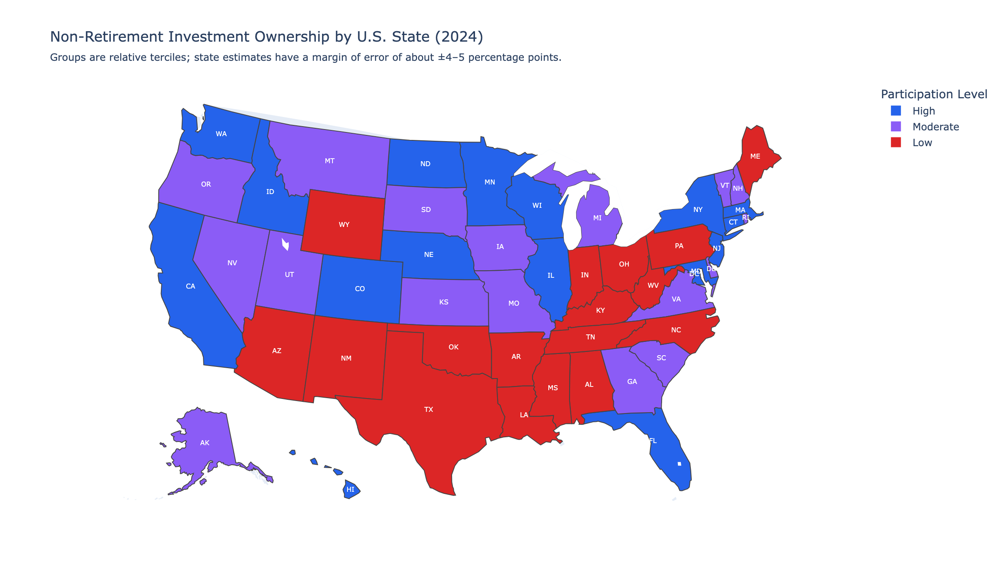

# Investment Participation in the United States

This project uses data from the FINRA Foundation’s 2024 National Financial Capability Study (NFCS) to explore differences in non-retirement investment ownership across U.S. states and Washington, D.C.

## Research question

How does reported ownership of stocks, bonds, mutual funds, or other securities outside retirement accounts vary across states?

## Data

The analysis uses the **2024 NFCS State-by-State Survey**, conducted by the FINRA Investor Education Foundation. The data are owned by the FINRA Foundation.

Download the State-by-State dataset from the [FINRA Foundation’s data and downloads page](https://www.finrafoundation.org/knowledge-we-gain-share/nfcs/data-and-downloads). Review and accept its terms of use before downloading or using the data.

The dataset is not included in this repository. After downloading and extracting it, place the CSV at:

```text
data/NFCS 2024 State Data 250623.csv
```

## Method

The notebook analyzes question `B14A_1`, which asks whether the respondent or their household has investments in stocks, bonds, mutual funds, or other securities **outside retirement accounts**.

For each state and Washington, D.C., the analysis calculates the percentage of yes responses among respondents who answered either yes or no. It uses FINRA’s `wgt_s3` state survey weight.

The analysis excludes “don’t know” and “prefer not to say” responses. It also excludes respondents who were skipped past the investment question under the survey’s routing rules. As a result, the percentages describe the included respondents and should not be interpreted as ownership rates for all adults or households.

The map places jurisdictions into three groups—low, moderate, and high—based on their relative rates in this dataset. These groups are not fixed ownership thresholds.

## Results



An interactive version with state tooltips is saved as `visualizations/ownership_map.html`. It loads plotly.js from a CDN, so it needs an internet connection.

## Run the project

1. Clone this repository and open it in VS Code.
2. Create and activate a Python virtual environment.
3. Install the dependencies:

   ```bash
   pip install -r requirements.txt
   ```

4. Download the FINRA data and place the CSV in the `data` folder as described above.
5. Open `notebooks/investment_analysis.ipynb`, select the virtual environment as the notebook kernel, and run the cells in order.

## Limitations

- The measure excludes investments held in retirement accounts and does not include the separate cryptocurrency question.
- Survey skips and non-responses are excluded, which may affect the estimates.
- State estimates are uncertain, and small differences or differences near category boundaries should be interpreted cautiously.
- State comparisons are descriptive and do not establish why ownership differs.
- The NFCS uses an online survey sample; estimates are subject to sampling and other survey limitations.

## Tools

- Python
- pandas
- Plotly (with Kaleido for image export)
- Jupyter Notebook